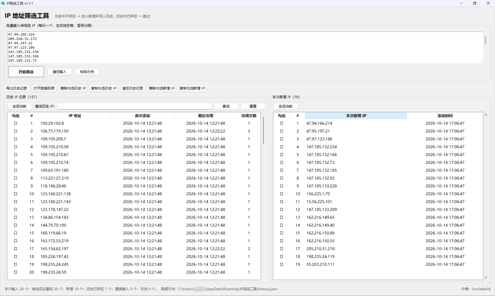

<div align="center">


# IP 筛选工具

<p>面向 Windows 的轻量级 IP 批量筛选、历史去重与清单管理工具。</p>


[下载最新版](https://github.com/UncleBlog/IPFilterTool/releases/latest) · [使用说明](docs/使用说明.md) · [版本记录](CHANGELOG.md)

</div>

---

## 项目简介

**IP 筛选工具**是一款为日常网络运维、设备清单整理、IP 资产核对而设计的 Windows 桌面工具。

你只需要把一批 IP 粘贴进输入框，工具会自动完成：

- 解析并校验 IPv4 / IPv6
- 自动去重并忽略无效项
- 与本地历史记录对比
- 历史中不存在的 IP 进入「本次新增 IP」并写入历史
- 历史中已存在的 IP 自动跳过

> 单文件运行，无需安装 Python；历史记录保存在本机，不依赖云服务。

### 界面预览

<div align="center">



<p><sub>左侧为历史 IP 记录，右侧为本次新增 IP；筛选结果一目了然，支持勾选、批量复制与删除。</sub></p>

</div>

## 功能亮点

| 能力 | 说明 |
| --- | --- |
| 批量输入 | 支持换行、空格、英文逗号、中文逗号、分号分隔 |
| IP 校验 | 支持 IPv4 与 IPv6，自动标准化格式 |
| 历史去重 | 只输出首次出现的新 IP，已存在 IP 自动跳过 |
| 历史查询 | 支持完整 IP 或部分 IP 模糊查询 |
| 勾选操作 | 历史记录与新增记录均支持单选、多选、复制、删除 |
| 全选切换 | 一键「全选当前」，再次点击「取消全选」 |
| 右键菜单 | 右击单个 IP 可直接复制或删除；右击已勾选 IP 可批量操作 |
| 复制历史 IP | 支持复制查询结果或勾选记录 |
| 新增清单管理 | 新增 IP 可独立勾选、复制、删除，并同步维护历史记录 |
| 本地持久化 | 数据保存为本地 JSON，关闭程序不会丢失 |
| CSV 导出 | 历史记录可导出 CSV，便于审计和归档 |
| 自定义图标 | 程序窗口与 exe 文件均使用专属图标 |

## 快速开始

1. 从 [Releases](https://github.com/UncleBlog/IPFilterTool/releases/latest) 下载 `IPFilterTool_v1.1.1.exe`。
2. 双击运行，无需安装。
3. 在输入框中粘贴 IP，支持以下格式：

```text
192.168.1.10
192.168.1.11, 10.0.0.1
2001:db8::1；2001:db8::2
```

4. 点击「开始筛选」。
5. 历史中不存在的 IP 会进入右侧「本次新增 IP」，并自动加入历史记录。
6. 使用勾选框、右键菜单或顶部按钮进行复制、删除和整理。

## 筛选规则

```text
输入 IP
  ├─ 无效项           → 跳过并在状态栏提示
  ├─ 重复输入         → 自动去重
  ├─ 历史中不存在     → 加入「本次新增 IP」 + 写入历史
  └─ 历史中已存在     → 跳过，不进入新增清单
```

## 操作指南

### 历史 IP 记录

- 勾选单个或多个 IP 后，可复制或删除勾选内容。
- 左侧按钮可在「全选当前」和「取消全选」之间切换。
- 右击未勾选的 IP，可直接复制或删除该 IP。
- 右击已勾选的 IP，可复制或删除全部已勾选 IP。
- 空格键切换当前行勾选状态，Delete 键删除已勾选 IP。
- 查询框支持右击「粘贴 IP」，也支持复制、全选和清空。

### 本次新增 IP

- 与历史 IP 使用相同的勾选、多选、全选、复制、删除和右键菜单操作。
- 新增记录区域不提供查询功能。
- 删除新增 IP 时，会同步从历史记录中移除，避免之后仍被判定为历史已存在。

## 下载与校验

最新版下载：

- **Release 页面**：https://github.com/UncleBlog/IPFilterTool/releases/latest
- **当前版本**：`v1.1.1`
- **适用系统**：Windows 10 / 11 x64
- **主程序**：`IPFilterTool_v1.1.1.exe`
- **图标文件**：`IPFilterTool_icon_v1.1.1.ico`

SHA256：

```text
D2C9FD071A4238ECBD2C8A77D59D1B20527208CCFCF1753D434E115D97448F5E
```

## 数据与隐私

历史记录保存在：

```text
%APPDATA%\IP筛选工具\history.json
```

程序不会上传 IP、历史记录或任何使用数据。所有筛选和历史管理均在本机完成。建议定期通过「导出历史记录」备份 CSV。

## 开发与构建

环境要求：

- Windows 10 / 11
- Python 3.11+
- PyInstaller
- Pillow（仅打包图标时需要）

安装依赖并构建单文件 exe：

```powershell
python -m pip install -r requirements-build.txt
.\build.ps1
```

构建产物位于：

```text
dist\IPFilterTool.exe
```

## 项目结构

```text
IPFilterTool/
├─ src/
│  ├─ ip_filter_app.py
│  └─ ip_filter.ico
├─ assets/
│  ├─ banner.png
│  ├─ icon.png
│  ├─ icon.ico
│  └─ screenshot.png
├─ docs/
│  └─ 使用说明.md
├─ build.ps1
├─ requirements-build.txt
├─ CHANGELOG.md
└─ README.md
```

## 版本记录

完整记录见 [CHANGELOG.md](CHANGELOG.md)。

## 作者

**Uncledavid**

如果这个工具对你有帮助，欢迎给项目点一个 Star。
